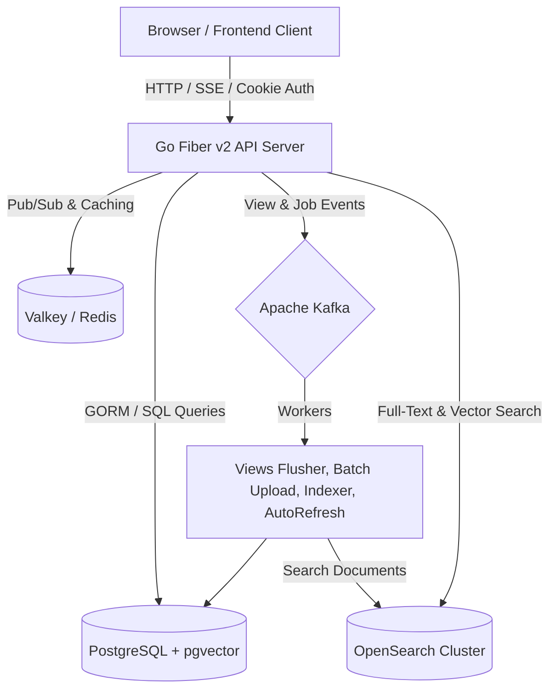

# Aurahub Architecture & Engineering Guide

This document defines the architectural patterns, directory boundaries, naming conventions, and development practices established in the Aurahub codebase.

---

## 1. System Overview

Aurahub is a modern video-sharing platform consisting of a high-concurrency Go (Fiber v2) backend and a reactive TypeScript/SvelteKit 2.x frontend.



---

## 2. Backend Architecture (`/backend`)

### Directory Structure & Responsibilities

| Directory | Responsibility | Inbound Rules |
| :--- | :--- | :--- |
| `api/` | HTTP handlers, routing, request parsing, and response formatting. | Receives fiber requests, invokes `Repository`, `Cache`, `Kafka`, and `OpenSearch`. |
| `config/` | Environment variable parsing, defaults, and configuration struct initialization (`config.LoadConfig()`). | Imported by `main.go`. Injected into `api.Server` via options. |
| `db/` | Database persistence layer: GORM models, automated schema migration, text/vector array handling, and repository queries. | Direct SQL / GORM queries live here. Never bypass this layer from handlers. |
| `internal/httpclient/` | Outbound HTTP client with connection pooling, retry policies, and external storage integrations (Streamtape, FreeImage). | Isolated from routing; provides typed HTTP utility functions. |
| `internal/kafka/` | Kafka producer, SASL/TLS authentication, topic configuration, and event message types. | Shared event infrastructure. |
| `internal/kafka/workers/` | Asynchronous Kafka event consumers (view counters, batch uploads, search index sync, auto-refreshers). | Run as background goroutines managed by `sync.WaitGroup`. |
| `internal/opensearch/` | OpenSearch client wrapper with fallback standby mode and sanitized credential logging. | Search indexing and querying. |
| `middleware/` | Fiber HTTP middleware: JWT verification, sliding-window rate limiters, security headers, client IP extraction. | Wrapped around routes in `SetupRoutes()`. |

### Handler Patterns & Rules

1. **Authentication Context**:
   - Always use `userId, ok := s.requireAuth(c); if !ok { return nil }` for protected routes.
   - For public routes where viewer identity is optional (e.g. view counts, personalized recommendations), use `viewerUUID, ok := s.getOptionalUserID(c)`.
   - Never use direct unverified type assertions like `c.Locals("userId").(string)` or silent error ignores `userId, _ := parseUUID(...)`.
2. **Context Propagation**:
   - Pass `c.UserContext()` to database, cache, and HTTP requests so client disconnections cancel backend work cleanly.
3. **Configuration Access**:
   - Access configuration properties through `s.getUploadFolderID()`, `s.getFreeImageAPIKey()`, `s.getJWTSecret()` or injected `Server` fields instead of making raw runtime `os.Getenv` calls in handler bodies.
4. **UUID Utilities**:
   - Use `parseUUID(str)` and `formatUUID(pgtype.UUID)` from `backend/api/utils.go`.

---

## 3. Frontend Architecture (`/frontend`)

### Directory Structure & Responsibilities

| Directory | Responsibility | Conventions |
| :--- | :--- | :--- |
| `src/routes/` | SvelteKit file-based routing pages and layouts. | Keep page routes thin. Delegate complex sections to focused components. |
| `src/lib/types/` | TypeScript domain interfaces (`user.ts`, `video.ts`, `comment.ts`, `playlist.ts`). | Centralized typed contracts matching API responses. Re-exported in `index.ts`. |
| `src/lib/components/` | Reusable UI components (`WatchComments.svelte`, `WatchSidebar.svelte`, `VideoThumbnail.svelte`, etc.). | PascalCase naming. Cohesive, single-responsibility components with typed props. |
| `src/lib/components/ui/` | Headless / design-system primitives (buttons, inputs, skeletons, dialogs). | Built on Tailwind CSS and shadcn conventions. |
| `src/lib/api.ts` | Centralized `fetchApi<T>()` client with adult content mode propagation and unified error parsing. | Returns `Promise<T>`. |
| `src/lib/user.svelte.ts` | Reactive user session store using Svelte 5 runes (`$state<{ user: User \| null; isLoaded: boolean }>`). | Strongly typed state. |
| `src/lib/consent.svelte.ts`| Reactive 18+ adult content preference and modal state. | LocalStorage sync. |

---

## 4. Coding & Naming Conventions

- **Go**:
  - `camelCase` for private package variables and methods (`requireAuth`, `parseUUID`).
  - `PascalCase` for exported types, handlers, and methods (`NewServer`, `SetupRoutes`).
  - Strict error handling: no blank identifier error drops (`_ = parseUUID(...)`).
- **TypeScript & Svelte**:
  - Svelte components: `PascalCase.svelte` (e.g., `WatchComments.svelte`).
  - TypeScript modules: `camelCase.ts` (e.g., `user.svelte.ts`, `thumbnailSvg.ts`).
  - Svelte 5 Runes: Prefer `$state`, `$derived`, and `$props` over Svelte 4 legacy stores.
  - Domain types: Always declare explicit interface fields; avoid `any`.

---

## 5. Verification & Testing Baseline

Before committing or opening a pull request, the following checks must pass:

```bash
# Backend test suite
cd backend
go test -v ./...

# Frontend type checking
cd frontend
npm run check

# Frontend production build
npm run build
```
